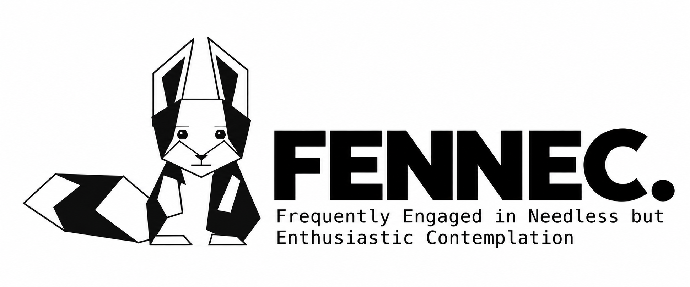

A curious little agent with very large ears: FENNEC chats in 24 languages, reads documents and articles, and occasionally remembers what you told it.

[FENNEC on the web →](https://l1001.vt.domains/fennec.html)

## What the fox does

- **Multilingual conversation:** choose an answer language independently of your question.
- **Two connections:** bring your own OpenAI or Virginia Tech ARC API key.
- **Research:** OpenAI web research and Python tools; ARC article exploration using Crossref abstracts. Each completed article suggests the next reading subject; an optional focus setting keeps the trail anchored.
- **Document reading:** TXT, PDF, HTML, and DOCX extraction in the browser, with chunked analysis for longer documents.
- **Read aloud:** browser speech synthesis, with available languages and voices depending on your browser.
- **Optional encrypted memory:** restore earlier conversations using the same API key. Memory starts off on every visit.
- **A geometric companion:** thinking, speaking, sleeping, reading, working, and writing animations, drawn directly on a canvas.
- **A notebook:** visible request/tool events and a downloadable session log. Previous conversations appear at the bottom of the page.

## Run it

The frontend is a complete HTML file with its document-reading libraries embedded. No frontend build step is required.

Upload `fennec.html` to an HTTPS web host and open it in your browser. Enter your own provider API key in **AI connection**. Keys remain in the tab and requests go directly to the selected provider; provider CORS support is required. Model and tool usage may incur provider charges. VT ARC requires an eligible account and personal ARC key.

The configured model names are `gpt-6-luna` and `DeepSeek-V4.1-Flash`. Availability depends on the provider/account; update `MODEL` and the ARC payload in `fennec.html` when adapting the app.

### Enable persistent memory on cPanel

Memory requires **PHP 8.1+ with PDO SQLite** in addition to the HTML. It can remain off if you want to use only chat.

1. Create `fennec-private` in your hosting account home, **outside `public_html` and every other website document root**. Set its permissions to `700`.
2. Copy `fennec-memory-config.example.php` to `fennec-memory-config.php`. Set the actual absolute `storage_dir`, all applicable `public_roots`, and your exact HTTPS `allowed_origin` (no trailing slash).
3. Upload `fennec.html`, `fennec-memory.php`, and your configured `fennec-memory-config.php` into the same website folder. Do not upload a real configuration file to GitHub.
4. PHP is a dashboard setting, not a File Manager directory: return to **cPanel → Software → MultiPHP Manager** to check the domain's version. If your host offers **Select PHP Version → Extensions**, enable `pdo_sqlite` there if needed; otherwise ask the host to enable it. It may already be available.
5. Open FENNEC over HTTPS, enter your key, and check **Enable persistent memory**. Wait for a completed exchange to report **Conversation encrypted and saved**.
6. Reload, enter the same key, and enable memory again. Previous conversations should return. The backend creates its database automatically.

See [the full setup and troubleshooting guide](SETUP.txt).

## How memory works

The browser uses the trimmed API key's SHA-256 hash as a public identifier. It derives **separate encryption and storage-access secrets from the original API key** using HKDF-SHA-256 with different purpose labels; provider labels separate the vaults. The public identifier is not an encryption key.

Each completed exchange is encrypted locally with AES-256-GCM, a fresh 12-byte nonce, and authenticated exchange metadata. PHP receives encrypted envelopes, an independent derived storage-access token, the identifier, and metadata—not the original API key, encryption key, or plaintext conversation. Both a dedicated header and Authorization carry the derived storage token for compatibility with CGI/FastCGI hosting. The server hashes it into the vault namespace rather than storing the token itself.

Writes are append-only and retries are idempotent. The browser loads the latest 50 exchanges and can load older pages. New AI requests recall up to the latest **seven exchanges**; the entire archive is not sent on every request. Questions with supplied passages and answers are each capped at 28,000 characters in saved exchanges. Transient document chunk analyses, partial replies, and internal tool logs are not saved as conversations.

Default limits are 16 MiB per vault, 128 MiB total plus SQLite overhead, and 120 requests per minute per IP. Limits can be changed in the configuration. Quota errors preserve existing history.

### Privacy and limits

- Memory is **off by default** and its preference is not persisted. Keys and decrypted conversations stay in tab memory; there is no browser persistent storage for them.
- The same provider/key combination unlocks the same vault. Shared keys share memory. There is no key recovery or migration feature; retain the old key if you need its history.
- Turning memory off or forgetting the key clears recalled context and stops future memory operations; it does not delete stored conversations.
- Relevant decrypted history is sent to the selected AI provider. Encryption protects the stored archive, not prompts from the provider.
- An administrator cannot decrypt the archive using the stored identifier or derived access token. A person controlling the website can modify its JavaScript to capture a key on a future visit; this design does not prevent that.
- Hosting logs and the backend can retain metadata. The user-requested notebook download is a **plaintext** session export.

## Autonomous reading

When enabled, FENNEC starts research after 30 seconds of inactivity while the tab is visible and a key is present. A completed article supplies a connected subject for the next reading: AI might lead to whale communication, then marine ecology. The **Next up** line shows the next subject and its connection to the article. The choice is generated in the same research response, with no extra model request, and is accepted only with valid metadata and a source citation. If no valid next subject is available, the current subject is retained.

Check **“Stay focused!”** to constrain new threads to the original topic. Searches include that original topic as well as the selected angle. The box starts unchecked. Editing the topic or changing the focus setting resets the trail; **Research now** starts from the entered topic and can seed a new trail. Trail state lasts only for this visit.

Clicks, typing, and scrolling still interrupt autonomous research and reset the timer—including minimizing the answer panel. Hidden tabs pause research. Enabled reading can continue beyond five minutes of inactivity; the five-minute sleep rule applies when automatic reading is off or no key is entered. Turn automatic reading off to stop the trail. An autonomous request error disables automatic reading until it is re-enabled. Model and tool charges continue to apply. The reading animation alone does not mean a research request is running.

## Files

| File | Purpose |
| --- | --- |
| `fennec.html` | Complete frontend, animation, provider requests, and encrypted-memory client |
| `fennec-memory.php` | HTTPS encrypted-memory endpoint backed by SQLite |
| `fennec-memory-config.example.php` | Safe deployment configuration template |
| `memory-client.js` | Reference copy of the embedded memory client; not a separate runtime dependency |
| `assets/fennec-logo.png` | Project logo |
| `SETUP.txt` | Detailed cPanel deployment guide |
| `tests/test-memory.mjs` | Browser/PHP integration checks using simulated AI responses |
| `tests/test-research.mjs` | Article trails, topic focus, idle scheduling, and provider checks |

When editing the memory client, update the embedded implementation in `fennec.html`; editing the reference copy alone does not change the running app.

## Development checks

The deployed app needs no Node dependencies. The test suite uses Node.js 24.18+ and development-only PHP WebAssembly and Playwright dependencies:

```sh
npm install
npx playwright install chromium
npm test
```

Tests execute the actual PHP backend and SQLite store in an isolated WebAssembly filesystem. They cover encryption, restoration, provider/key isolation, failed-save retry, tamper rejection, pagination, quotas, HTTPS/origin checks, and memory state in provider instructions. AI responses are simulated; no live API key or paid model request is needed. The reading suite checks linked subjects, topic focus, invalid metadata, and continuous idle reading with simulated sources. Screenshots go to `tests/artifacts/`.

Set `PLAYWRIGHT_CHROMIUM_EXECUTABLE_PATH` if you need to use a separately installed Chromium executable.

## License

FENNEC's original code, documentation, and project artwork are released under the [MIT License](LICENSE). Embedded document-reading libraries retain their upstream licenses; see [third-party notices](THIRD_PARTY_NOTICES.md).
