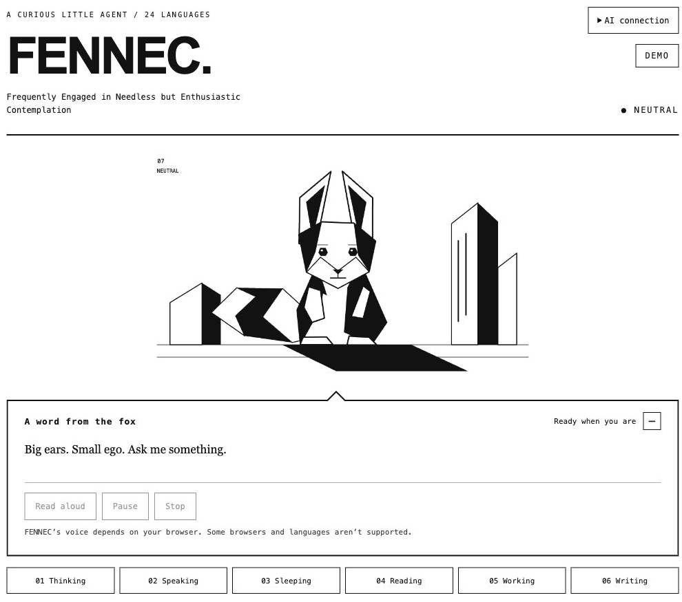
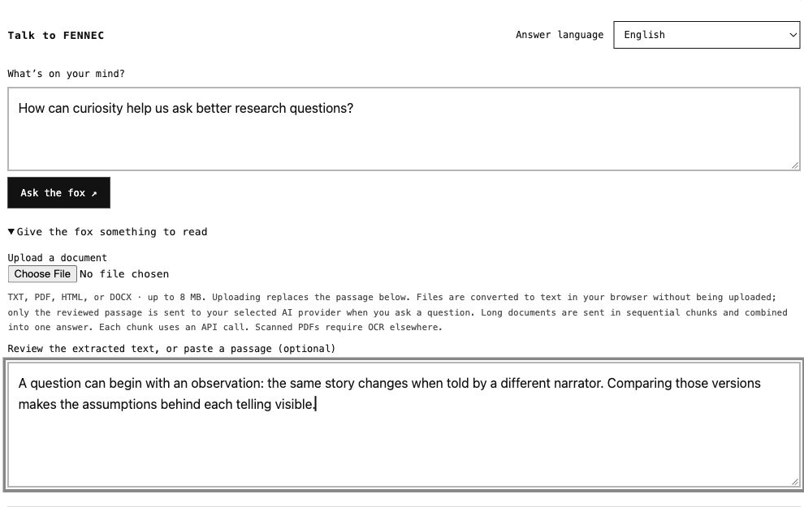
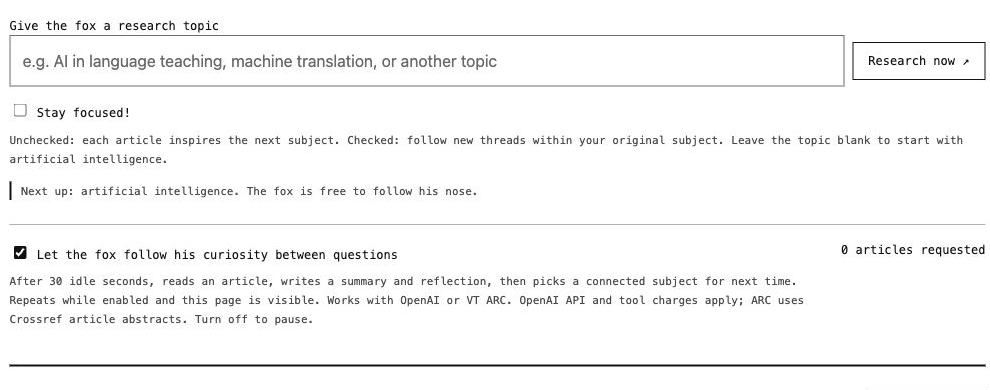
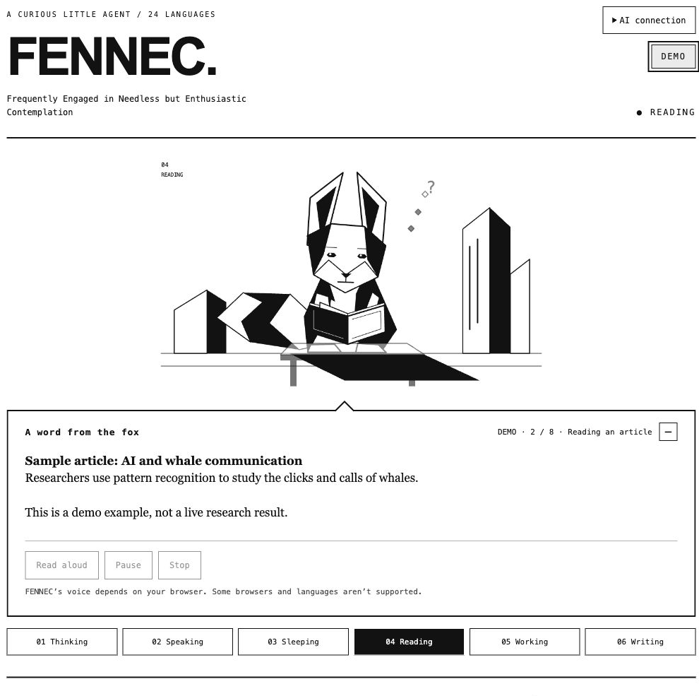

# FENNEC: A Browser-Based Conversational and Research Companion

William Taggart  
Modern and Classical Languages and Literatures, Virginia Tech  
wtaggart@vt.edu

November 14, 2026

## Abstract

FENNEC combines multilingual conversation, document reading, article exploration, speech synthesis, and optional encrypted conversation storage in a browser interface. A geometric fox communicates activity through animation, while explicit controls distinguish user requests, autonomous research, and a local demonstration. This report explains provider routing, long-document reduction, research-state transitions, browser-side key derivation, and the limits of citation and privacy assurances. It describes the implementation and interface rather than reporting an evaluation of answer quality.

## Purpose and Research Context

FENNEC, Frequently Engaged in Needless but Enthusiastic Contemplation, brings multilingual conversation, document reading, and research into a single browser interface. A user can begin with a question and an optional passage, then choose an answer in any of 24 selectable languages, independently of the question's language. From that starting point, article exploration and optional conversation memory extend the exchange beyond an isolated response. The design aims to keep those additional operations visible and deliberate, so that the user can distinguish answering a question from gathering material or retaining an exchange. The animated fox helps communicate these activity states, while the underlying operations and their results determine whether work has actually completed.

This distinction between a conversational response and an external action connects FENNEC to research on language-model tool use. ReAct interleaves reasoning with external actions, and Toolformer investigates learning when and how to call tools ([Yao et al., 2022](https://arxiv.org/abs/2210.03629); [Schick et al., 2023](https://arxiv.org/abs/2302.04761)). These approaches make the coordination of language and action an explicit part of the system. FENNEC addresses that coordination at the application level, routing requests and managing state around existing provider models. In this setting, WebGPT's browser-assisted answering and WebArena's evaluation of website tasks help clarify why fluent conversation and successful action require separate assessment ([Nakano et al., 2021](https://arxiv.org/abs/2112.09332); [Zhou et al., 2023](https://arxiv.org/abs/2307.13854)). Progress feedback should consequently make completed operations and their evidence inspectable, rather than asking the user to infer success from an animation or a plausible answer.

*Figure 1. FENNEC at rest, with its geometric fox and answer panel.*

Once an operation retrieves an article, the next question is how that material supports the response. Retrieval-augmented generation combines generation with retrieved information, while Self-RAG studies learned decisions about retrieval and critique ([Lewis et al., 2020](https://arxiv.org/abs/2005.11401); [Asai et al., 2023](https://arxiv.org/abs/2310.11511)). STORM extends the research workflow by organizing information gathering and planning before long-form writing ([Shao et al., 2024](https://arxiv.org/abs/2402.14207)). FENNEC shares an interest in connecting discovery to subsequent use, but implements a smaller article-to-article exploration loop. It does not reproduce those trained architectures or their full writing pipelines. Within its more limited workflow, the separation of answer quality from citation quality in ALCE is particularly useful ([Gao et al., 2023](https://aclanthology.org/2023.emnlp-main.398/)): identifying a source through a valid title, identifier, or URL is one step, and establishing that its content supports a claim is another. Keeping these steps distinct provides a basis for reviewing both the retrieved material and the answer built from it.

The same concern with evidence continues when the material comes from a longer document or a stored conversation. In both cases, the application selects what enters a request, and that selection influences what the model can use. Lost in the Middle reports sensitivity to the position of relevant information within a context ([Liu et al., 2023](https://arxiv.org/abs/2307.03172)), giving a further reason to examine how reading material is reduced and conversational memory is chosen. Accepting a complete file therefore does not establish that every passage contributes to the final answer. FENNEC's document-reduction and memory mechanisms make this question part of the implementation that must be inspected and evaluated.

Taken together, these concerns define the report's focus on request coordination, evidence handling, and the states presented to the user. The following sections trace how the application moves from a question or document to provider requests, research activity, and optional storage. Evaluation must then ask whether the intended operations complete, whether the answers are supported, and which information survives selection and reduction. The interface makes these processes available for scrutiny; their reliability and the quality of their results require separate evidence.

## Architecture and provider boundary

The frontend is a self-contained HTML application with JavaScript, canvas rendering, and embedded document-reading libraries. Conversation requests travel directly from the browser to the selected provider. The optional PHP and SQLite service stores encrypted conversation entries; it is not a proxy for inference. Hosting the frontend alone supports conversation when the provider permits browser-origin requests. Persistent memory additionally requires the configured PHP service and private storage outside the public web root.

Users choose OpenAI or Virginia Tech ARC and supply a personal API key. The inspected configuration names gpt-6-luna and DeepSeek-V4.1-Flash; these are configurable identifiers, not a promise of account-level availability. OpenAI research can use web and Python tools. The ARC path obtains article metadata and abstracts through Crossref. The two routes consequently expose different evidence and tool capabilities. Switching providers starts a fresh provider conversation rather than forwarding the other service's history.

Keys remain in tab memory, and provider use can incur charges. Local document extraction does not mean local inference: question text, selected reading material, and relevant conversational context are sent to the chosen service when a request is made. Speech output uses browser speech synthesis, so voice and language coverage depend on the browser and operating system.

## Document reading and reduction

The document input accepts TXT, PDF, HTML, and DOCX, with an 8 MB upload limit. Extraction occurs in the browser and leaves editable text for review. Formatting, OCR, and complex document structure are not guaranteed to survive extraction. The user can also paste a passage directly. The question and this reviewed text form the document-analysis task.

*Figure 2. Question and reviewed document input; the passage is illustrative text entered for this report.*

Reading text of at most 18,000 characters is handled in a single request. Longer input is partitioned into chunks of approximately 16,000 characters, preferring a newline boundary after the midpoint and avoiding a split inside a surrogate pair. The partitioner retains every source character once; this coverage property concerns input segmentation, not completeness of the model's interpretation.

Each chunk produces brief notes, after which groups of notes are recursively condensed until the combined notes fit the final synthesis budget. A non-shrinking condensation is rejected instead of allowing an indefinite loop. Intermediate requests are transient and are not saved as ordinary conversation exchanges. This is a bounded-context reduction strategy: compression can omit details, conflicting evidence, or subtle dependencies between distant passages. The final answer should therefore be checked against the original document when precision matters.

## Research state and visible activity

A research topic establishes an initial query. Stay focused retains that anchor; otherwise a validated article result may suggest the next topic. With an appropriate connection and the research option enabled, a visible idle tab can start exploration after roughly 30 seconds. User interaction resets the idle interval, and a hidden tab pauses this behavior. Failure disables automatic research until the user re-enables it. Validation of structured article metadata and citations precedes advancement to the next topic.

*Figure 3. Research-topic controls, focus policy, and the explicit autonomous-research switch.*

The visible notebook records request and tool events. It distinguishes background resting poses from actual research work, and it can be downloaded as a session record. Thinking, speaking, sleeping, reading, working, and writing animations are presentation states. They do not measure model reasoning or independently prove that a network operation succeeded.

A built-in demonstration cycles through eight local scenes, approximately five seconds per scene. It makes no provider requests and performs no persistent-memory writes. Exiting restores the previous state. This gives users a way to inspect the interface without credentials; the labeled sample article in Figure 4 is demonstration content rather than a retrieved research result.

*Figure 4. The built-in, labeled demonstration presents sample activity without making a live research request.*

## Optional encrypted conversation memory

Memory starts disabled on every visit. When enabled, the browser derives a public identifier from the trimmed API key using SHA-256. HKDF-SHA-256 [5] derives separate encryption and storage-access material with provider- and purpose-specific context. Entries use AES-256-GCM with a fresh 12-byte initialization vector and associated data binding the provider, identifier, and entry identifier. The service receives ciphertext and derived access material, not the provider key or the browser's encryption key.

The service provides append-only, idempotent storage and paginated retrieval. The latest seven exchanges can enter model context; the interface can fetch older history in pages of 50 entries. Questions and answers have storage length limits. Default service quotas bound individual vault size, aggregate storage, and request rate. These are operational limits, not an anonymity mechanism: the server still sees connection metadata and storage activity.

Using the same provider key restores the same vault, so sharing a key also shares access to its history. Key rotation can make an old vault inaccessible unless its contents were exported; disabling memory does not delete prior records. A downloaded notebook is plaintext. The frontend must remain trustworthy because modified JavaScript could capture secrets on a later visit. Encryption at rest therefore addresses a narrower threat than a compromised browser or compromised frontend delivery.

## Reproducibility and limitations

The source repository includes frontend code, a configurable memory endpoint, and tests using simulated provider responses and backend fixtures. The interface captures in this report show credential-free interaction and the explicitly labeled demo. No live-provider quality benchmark, penetration test, or multilingual evaluation is reported here. Deployment requires HTTPS, suitable provider cross-origin access, and, for memory, PHP 8.1 or later with PDO SQLite and correctly restricted storage.

The main limitations are model-dependent factual accuracy, lossy long-document reduction, incomplete article access, browser-dependent extraction and speech, and the trust boundary of delivered JavaScript. Future evaluation should test citation support, information retained through repeated condensation, accessibility, and recovery from provider interruptions separately. Successful rendering or schema validation alone cannot establish those properties.

## AI disclosure

This project was created with assistance from GPT-6 Astra and Codex. AI tools assisted with implementation and with drafting, checking, and formatting this report. William Taggart directed the project. This disclosure does not imply independent human validation of every generated statement; the implementation and cited sources remain available for review.

## References

1. Shunyu Yao, Jeffrey Zhao, Dian Yu, Nan Du, Izhak Shafran, Karthik Narasimhan, Yuan Cao (2022). [ReAct: Synergizing Reasoning and Acting in Language Models](https://arxiv.org/abs/2210.03629). arXiv:2210.03629.

2. Timo Schick, Jane Dwivedi-Yu, Roberto Dessì, Roberta Raileanu, Maria Lomeli, Luke Zettlemoyer, Nicola Cancedda, Thomas Scialom (2023). [Toolformer: Language Models Can Teach Themselves to Use Tools](https://arxiv.org/abs/2302.04761). arXiv:2302.04761.

3. Yijia Shao, Yucheng Jiang, Theodore A. Kanell, Peter Xu, Omar Khattab, Monica S. Lam (2024). [Assisting in Writing Wikipedia-like Articles From Scratch with Large Language Models](https://arxiv.org/abs/2402.14207). arXiv:2402.14207.

4. Tianyu Gao, Howard Yen, Jiatong Yu, Danqi Chen (2023). [Enabling Large Language Models to Generate Text with Citations](https://aclanthology.org/2023.emnlp-main.398/). Proceedings of EMNLP; doi:10.18653/v1/2023.emnlp-main.398.

5. Hugo Krawczyk, Pasi Eronen (2010). [HMAC-based Extract-and-Expand Key Derivation Function (HKDF)](https://www.rfc-editor.org/rfc/rfc5869). RFC 5869.
6. Lewis, Patrick, Perez, Ethan, Piktus, Aleksandra, Petroni, Fabio, Karpukhin, Vladimir, Goyal, Naman, Küttler, Heinrich, Lewis, Mike, Yih, Wen-tau, Rocktäschel, Tim, Riedel, Sebastian, Kiela, Douwe (2020). [Retrieval-Augmented Generation for Knowledge-Intensive NLP Tasks](https://arxiv.org/abs/2005.11401). DOI: 10.48550/arXiv.2005.11401.

7. Asai, Akari, Wu, Zeqiu, Wang, Yizhong, Sil, Avirup, Hajishirzi, Hannaneh (2023). [Self-RAG: Learning to Retrieve, Generate, and Critique through Self-Reflection](https://arxiv.org/abs/2310.11511). DOI: 10.48550/arXiv.2310.11511.

8. Nakano, Reiichiro, Hilton, Jacob, Balaji, Suchir, Wu, Jeff, Ouyang, Long, Kim, Christina, Hesse, Christopher, Jain, Shantanu, Kosaraju, Vineet, Saunders, William, Jiang, Xu, Cobbe, Karl, Eloundou, Tyna, Krueger, Gretchen, Button, Kevin, Knight, Matthew, Chess, Benjamin, Schulman, John (2021). [WebGPT: Browser-assisted question-answering with human feedback](https://arxiv.org/abs/2112.09332). DOI: 10.48550/arXiv.2112.09332.

9. Zhou, Shuyan, Xu, Frank F., Zhu, Hao, Zhou, Xuhui, Lo, Robert, Sridhar, Abishek, Cheng, Xianyi, Ou, Tianyue, Bisk, Yonatan, Fried, Daniel, Alon, Uri, Neubig, Graham (2023). [WebArena: A Realistic Web Environment for Building Autonomous Agents](https://arxiv.org/abs/2307.13854). DOI: 10.48550/arXiv.2307.13854.

10. Liu, Nelson F., Lin, Kevin, Hewitt, John, Paranjape, Ashwin, Bevilacqua, Michele, Petroni, Fabio, Liang, Percy (2023). [Lost in the Middle: How Language Models Use Long Contexts](https://arxiv.org/abs/2307.03172). DOI: 10.48550/arXiv.2307.03172.

## Suggested Citation

William Taggart. 2026. FENNEC: A Browser-Based Conversational and Research Companion. Technical report. Modern and Classical Languages and Literatures, Virginia Tech. https://github.com/FL2744/FENNEC
